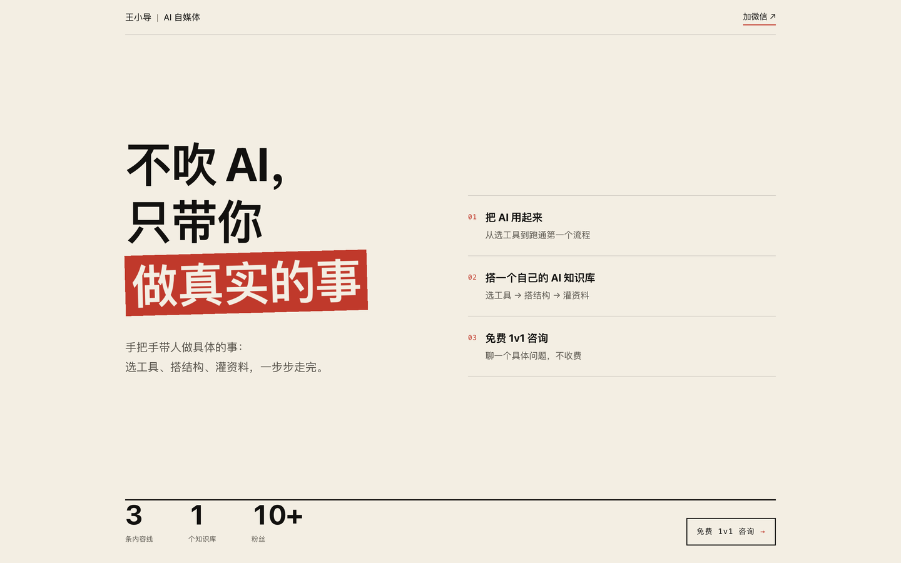
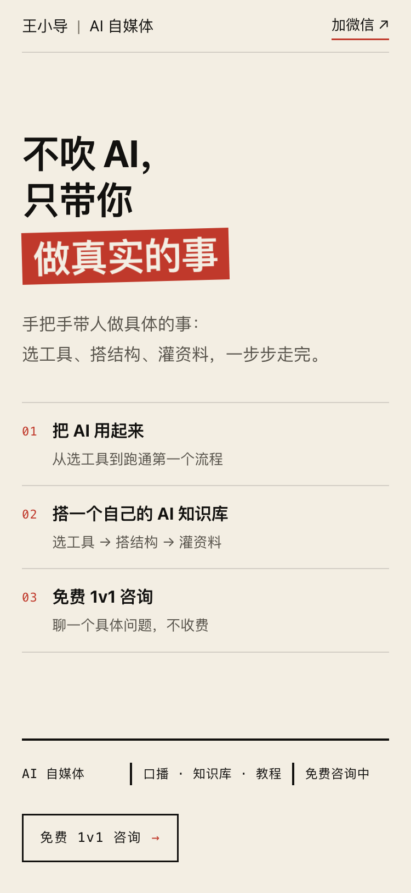

# 王小导 · 个人主页

> 不吹 AI，只带你做真实的事。

一个纯静态的个人主页。没有框架、没有构建步骤、没有外部 CDN，一个 `index.html` 打开就能看。

<table>
<tr>
<td width="72%"></td>
<td width="28%"></td>
</tr>
<tr>
<td align="center"><sub>电脑端 · 1440 × 900</sub></td>
<td align="center"><sub>手机端 · 375 × 812</sub></td>
</tr>
</table>

## 页面结构

| 区块 | 内容 |
|---|---|
| 首屏 | 一句话主张、三条「我能帮你做什么」、底部数字（3 条内容线 / 1 个知识库 / 10+ 粉丝）与免费咨询入口 |
| 01 关于我 | 头像 + 三段第一人称自述 |
| 02 在做的事 | 三张硬边卡片：AI 知识库、口播练习、公众号 AI 实操教程 |
| 数字带（手机端） | 墨黑底色，三条内容线 / 1 个知识库 / 10+ 粉丝；桌面端这组数字在首屏底部 |
| 咨询 | 免费 1v1 咨询，一键复制微信号 |
| 页脚 | 署名与年份 |

## 技术说明

- **单文件**：HTML、CSS、JS 全部内联在 `index.html` 里，约 18 KB，无任何依赖。
- **不引外部资源**：不用 Google Fonts、不用 Tailwind CDN、不加载任何第三方脚本。字体走系统字体栈（PingFang SC / HarmonyOS Sans / MiSans / 微软雅黑），国内打开无需等待。
- **手机优先**：375px 起排版，600px 转平板两栏，900px 转桌面三栏。任何宽度都不会出现横向滚动条。
- **动效克制**：首屏逐级上浮、贴纸归位、数字滚动一次。全部只动 `transform` 和 `opacity`，不触发重排。
- **尊重系统设置**：开启「减少动态效果」的用户，所有动效自动关闭，数字直接显示终值。
- **可访问性**：语义化标签、焦点可见、复制按钮带 `aria-label`、颜色对比度全部达标。

## 本地预览

直接双击 `index.html` 即可。或者起一个本地服务：

```bash
python3 -m http.server 8000
# 打开 http://localhost:8000
```

## 文件说明

```
.
├── index.html          # 主页（全部代码都在这里）
├── og-image.png        # 分享卡片图 1200×630
├── screenshots/        # README 用的首屏截图
├── profile.md          # 内容源：采访整理出的个人资料
└── design-plan.md      # 设计稿：配色、字体、模块顺序、动效说明
```

## 关于内容

页面上所有文字都来自 `profile.md`，没有编造的经历、数据和联系方式。暂时没有的信息就不显示，不做占位。

---

<sub>2026 · 王小导</sub>
